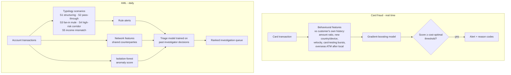

# 🛡️ Bank Fraud & AML Monitoring

**Catch card fraud as it happens and cut money-laundering alert workload, with explanations an
investigator or regulator can follow.** Combines real-time card fraud scoring with AML typology
scenarios and a machine-learning triage model that ranks the investigation queue.

> Data: synthetic retail-banking data: 3,000 customers, 860,000 card transactions and 90,000 account
> transactions over 6 months, with labelled fraud patterns, money-laundering typologies, and legitimate
> behaviour that *looks* suspicious (travel, new phones, property purchases, shop owners banking cash,
> family remittances) so false positives are realistic.

---

## The business problem

- **Card fraud** is rare (here 0.08% of transactions) but expensive. Legacy rules either miss it or flood
  the team with alerts, and every alert means an analyst review and often a customer call.
- **AML monitoring** is a regulatory obligation. Scenario rules are explainable and expected by
  regulators, but typically **90%+ of alerts are false positives**, so investigators spend most of their
  time closing legitimate cases.

## Results

### Card fraud (test period May–June 2026, trained on January–April)

| Approach | Alerts | Fraud caught | Precision | Fraud loss | Total cost* |
|---|---|---|---|---|---|
| No monitoring | 0 | 0 / 237 | – | AED 1.03M | AED 1.03M |
| Legacy rules | 1,272 | 112 / 237 | 9% | AED 430K | AED 462K |
| **ML model** | **901** | **230 / 237** | **26%** | **AED 56K** | **AED 78K** |

\*Total cost = fraud losses + AED 25 per alert reviewed. The alert threshold is chosen to minimise this
cost on a validation month, never on the test period.

**Fewer alerts, double the fraud caught, 83% lower cost than the rules.** Every alert comes with reason codes,
for example *"Burst of tiny online payments (card testing) · Overseas transaction · Many transactions in the last hour"*.

### AML monitoring (alerts April–June 2026, triage trained on January–March decisions)

- Scenario rules cover **99% of the planted laundering customers** (structuring, money mules, rapid
  pass-through, high-risk corridors), but **92% of their alerts are false positives**.
- The triage model puts **95% of truly suspicious cases in the top 20% of the queue**.
- Reaching 90% of suspicious cases needs **125 reviews instead of 771: an 84% workload reduction**,
  with the rules still in place as the safety net.

The synthetic fraud patterns are cleaner than real ones, so real-world accuracy would be lower; the
method (time-based validation, cost-based thresholds, rules + ML triage) is what carries over.

---

## How it works



| Component | Where |
|---|---|
| Synthetic data with fraud patterns, laundering typologies and legitimate look-alikes | `src/fincrime/data.py` |
| Card fraud features, model, cost-based threshold, rules baseline, reason codes | `src/fincrime/fraud.py` |
| AML scenarios, customer-counterparty network, anomaly score, triage model | `src/fincrime/aml.py` |
| End-to-end run and report | `src/fincrime/pipeline.py` |
| Fraud and AML queues dashboard | `dashboard.py` |

## Quick start

```bash
git clone https://github.com/vineethasusan/uae-bank-fraud-aml.git
cd uae-bank-fraud-aml
python -m venv .venv && source .venv/bin/activate
make install
make pipeline     # ~2 minutes -> outputs/report.md, fraud_alert_queue.csv, aml_alert_queue.csv
make dashboard    # http://localhost:8501
```

## Design decisions

- **Compare each transaction with the customer's own normal**, not with everyone: AED 5,000 is ordinary for a
  private-banking client and alarming for a mass-market one.
- **No look-ahead.** Every fraud feature uses only earlier transactions (tested), so the same code can score live.
- **Choose thresholds in money.** Missed fraud costs its amount; each alert costs analyst time. The threshold that
  minimises the total is picked on a validation month.
- **Keep the rules, add triage.** Regulators expect explainable scenario coverage, so ML re-orders the queue rather
  than silently suppressing alerts. Every alert is still reviewed in priority order.
- **Network signals.** Money mules share counterparties; a customer linked to other alerted customers is riskier.
- **Imperfect labels.** Triage is trained on historical investigator decisions, which include mistakes (simulated),
  as in real banks.

## Project structure

```
uae-bank-fraud-aml/
├── src/fincrime/
│   ├── data.py       # synthetic customers, card and account transactions
│   ├── fraud.py      # card fraud model
│   ├── aml.py        # AML scenarios and triage
│   └── pipeline.py   # end-to-end run
├── dashboard.py
├── tests/            # feature leakage, scenario logic, model-vs-rules tests
└── Dockerfile, Makefile, .github/workflows/ci.yml
```

## Roadmap

- Graph machine learning on the full customer-counterparty network to find mule rings
- Real-time scoring service (FastAPI + Kafka) reusing the streaming pattern from `Real-time-GPS-anomaly-detection-with-Kafka`
- LLM-drafted case narratives for investigators, from the alert's facts
- Model risk management pack: monitoring, drift checks and challenger models

## Author

**Vineetha Susan Alexander** · Senior Data Scientist & AI Consultant, Dubai
[LinkedIn](https://www.linkedin.com/in/vineetha-susan-alexander-465997135) · [GitHub](https://github.com/vineethasusan)

MIT License.
